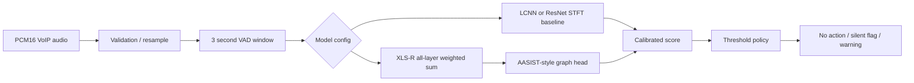

# AI-Powered Real-Time Detection and Prevention of Voice Cloning Impersonation Attacks

This repository contains a production-oriented DSP-only research foundation:

- FastAPI REST and WebSocket APIs under `/api/v1`.
- Validated 8/16/48 kHz audio, bounded RAM-only buffers, 3-second sliding windows, and energy VAD.
- Deterministic FFT/STFT, spectral, Mel/DCT, pitch-proxy, phase, and speech-activity features.
- Trainable scikit-learn DSP detector, calibration utility, weighted fusion, and discounted Bayesian risk.
- Grouped manifest/split and evaluation metric utilities.
- Optional ONNX and ZenML boundaries without a deep model or synthetic research results.
- Docker Compose services for API, Redis, MongoDB, and MLflow.

The deep-learning backbone, remote SSH dataset access, AWS provisioning, and frontend are intentionally deferred. No raw audio is persisted. See the `docs/` directory.

## Quick start

```bash
python -m venv .venv
. .venv/bin/activate
python -m pip install -r requirements-core.txt
uvicorn app.main:app --reload
```

Then open `http://localhost:8000/docs`. For local infrastructure use `docker compose up --build`.

## Train the detector

Create `data/manifest.csv` with `location,label`, where `0` is human and `1` is AI:

```bash
python -m pip install -r requirements-core.txt -r requirements-ml.txt
python scripts/train_neural.py --config configs/train.yaml --device cuda
python scripts/calibrate_neural.py --config configs/train.yaml --checkpoint artifacts/checkpoints/best.pt
python scripts/evaluate_neural.py --config configs/train.yaml --checkpoint artifacts/checkpoints/best.pt --calibration artifacts/calibration/calibration.json
```

Select `xlsr_aasist` in `configs/train.yaml` to download the Hugging Face XLS-R checkpoint. Keep the checkpoint revision/cache controlled for reproducibility.

## Architecture



## Deployment trade-off

ECS EC2 GPU provides control over GPU instance capacity, WebSocket behavior, and cost tuning, but requires AMI, autoscaling, patching, and capacity management. SageMaker real-time endpoints provide managed model deployment and autoscaling, but introduce endpoint packaging constraints, per-endpoint cost, and a less direct fit for long-lived bidirectional WebSocket sessions. The checked-in Terraform defaults to parameterized ECS EC2 GPU resources; no AWS resources are created automatically.
